<!-- AUTOGERADO por scripts/render_profile.py: editar o gerador, não este arquivo. -->

<a href="https://cassiano.tech"><picture><source media="(prefers-reduced-motion: reduce)" srcset="./cards/static/hero.svg" /></picture></a>

<a href="https://cassiano.tech"><picture><source media="(prefers-reduced-motion: reduce)" srcset="./cards/static/tile-portfolio.svg" /></picture></a>
<a href="https://www.linkedin.com/in/cassiano-b-santos"><picture><source media="(prefers-reduced-motion: reduce)" srcset="./cards/static/tile-linkedin.svg" /></picture></a>
<a href="https://github.com/CBS041?tab=repositories"><picture><source media="(prefers-reduced-motion: reduce)" srcset="./cards/static/tile-github.svg" /></picture></a>

### Projetos fixados

<a href="https://github.com/CBS041/portfolio-cassiano"><picture><source media="(prefers-reduced-motion: reduce)" srcset="./cards/static/repo-01.svg" /></picture></a>
<a href="https://github.com/CBS041/spotted-external-api"><picture><source media="(prefers-reduced-motion: reduce)" srcset="./cards/static/repo-02.svg" /></picture></a>

<a href="https://github.com/CBS041/parceladao-hidra"><picture><source media="(prefers-reduced-motion: reduce)" srcset="./cards/static/repo-03.svg" /></picture></a>
<a href="https://github.com/CBS041/desafio-discover-rocketseat"><picture><source media="(prefers-reduced-motion: reduce)" srcset="./cards/static/repo-04.svg" /></picture></a>

### Atividade

<picture><source media="(prefers-reduced-motion: reduce)" srcset="./cards/static/activity.svg" /></picture>
<picture><source media="(prefers-reduced-motion: reduce)" srcset="./cards/static/contributions.svg" /></picture>

TypeScript · Node.js · React · Next.js · PostgreSQL · Docker

Aprender construindo. Melhorar refatorando. Evoluir entregando.

<!-- Fixados e descrições sincronizados pela API GraphQL do GitHub. -->
